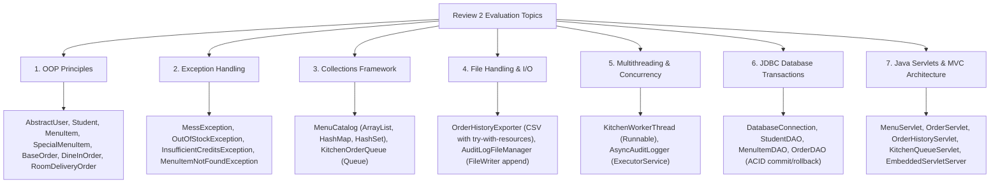

# SmartMess: Review 2 Java Concepts Implementation Guide

> [!IMPORTANT]
> **Existing Project Safety Guarantee**:
> **Zero existing files were deleted, modified, or moved.** The React frontend (`frontend/`), Express/Node.js backend (`backend/`), and live PostgreSQL database schema remain 100% untouched. All Review 2 Java requirements are cleanly encapsulated in the self-contained module:
> `smartmess-java/`

---

## 1. Quick Start: How to Run the Demonstration

### A. Run the Complete Review 2 Demonstration Suite
Executes all 7 core Java topics end-to-end with live tests against Neon PostgreSQL:
```bash
cd smartmess-java
bash run.sh
```
*(Or compile explicitly first using `bash build.sh && bash run.sh`)*

### B. Run the Standalone Java Servlet Container
Starts the embedded servlet container serving HTTP API endpoints on port `8080`:
```bash
cd smartmess-java
bash run.sh server 8080
```
**Active Servlet Endpoints:**
- `GET  http://localhost:8080/api/java/menu?healthy=true` → Handled by [`MenuServlet`](file:///Users/rohit/.gemini/antigravity/scratch/smart-campus-mess/smartmess-java/src/main/java/com/smartmess/servlet/MenuServlet.java)
- `POST http://localhost:8080/api/java/order` → Handled by [`OrderServlet`](file:///Users/rohit/.gemini/antigravity/scratch/smart-campus-mess/smartmess-java/src/main/java/com/smartmess/servlet/OrderServlet.java)
- `GET  http://localhost:8080/api/java/history?studentId=22` → Handled by [`OrderHistoryServlet`](file:///Users/rohit/.gemini/antigravity/scratch/smart-campus-mess/smartmess-java/src/main/java/com/smartmess/servlet/OrderHistoryServlet.java)
- `GET  http://localhost:8080/api/java/kitchen` → Handled by [`KitchenQueueServlet`](file:///Users/rohit/.gemini/antigravity/scratch/smart-campus-mess/smartmess-java/src/main/java/com/smartmess/servlet/KitchenQueueServlet.java)

---

## 2. All 7 Java Concepts & File Mapping



### 1. Object-Oriented Programming (OOP)
- **Encapsulation**: Private fields with strictly validated getters/setters across all model entities.
- **Abstraction**:
  - [`AbstractUser`](file:///Users/rohit/.gemini/antigravity/scratch/smart-campus-mess/smartmess-java/src/main/java/com/smartmess/model/AbstractUser.java): Abstract base class defining common credentials and abstract method `getDashboardView()`.
  - [`IMessService`](file:///Users/rohit/.gemini/antigravity/scratch/smart-campus-mess/smartmess-java/src/main/java/com/smartmess/service/IMessService.java): High-level service interface decoupling business logic from implementation.
- **Inheritance**:
  - [`Student`](file:///Users/rohit/.gemini/antigravity/scratch/smart-campus-mess/smartmess-java/src/main/java/com/smartmess/model/Student.java) extends [`AbstractUser`](file:///Users/rohit/.gemini/antigravity/scratch/smart-campus-mess/smartmess-java/src/main/java/com/smartmess/model/AbstractUser.java).
  - [`SpecialMenuItem`](file:///Users/rohit/.gemini/antigravity/scratch/smart-campus-mess/smartmess-java/src/main/java/com/smartmess/model/SpecialMenuItem.java) extends [`MenuItem`](file:///Users/rohit/.gemini/antigravity/scratch/smart-campus-mess/smartmess-java/src/main/java/com/smartmess/model/MenuItem.java).
  - [`DineInOrder`](file:///Users/rohit/.gemini/antigravity/scratch/smart-campus-mess/smartmess-java/src/main/java/com/smartmess/model/DineInOrder.java) & [`RoomDeliveryOrder`](file:///Users/rohit/.gemini/antigravity/scratch/smart-campus-mess/smartmess-java/src/main/java/com/smartmess/model/RoomDeliveryOrder.java) extend [`BaseOrder`](file:///Users/rohit/.gemini/antigravity/scratch/smart-campus-mess/smartmess-java/src/main/java/com/smartmess/model/BaseOrder.java).
- **Polymorphism**:
  - `BaseOrder.generatePickupToken()`: Dynamic dispatch generates `TK-XXXX` for dine-in/pickup orders and `ROOM-TK-XXXX` for sick-leave hostel room delivery orders.
  - `MenuItem.getItemType()`: Polymorphically displays whether an item is regular or next-day chef special.

### 2. Exception Handling
- **Custom Checked Exception Hierarchy**:
  - [`MessException`](file:///Users/rohit/.gemini/antigravity/scratch/smart-campus-mess/smartmess-java/src/main/java/com/smartmess/exception/MessException.java): Base application exception.
  - [`OutOfStockException`](file:///Users/rohit/.gemini/antigravity/scratch/smart-campus-mess/smartmess-java/src/main/java/com/smartmess/exception/OutOfStockException.java): Thrown when requested portions exceed available cafeteria stock.
  - [`InsufficientCreditsException`](file:///Users/rohit/.gemini/antigravity/scratch/smart-campus-mess/smartmess-java/src/main/java/com/smartmess/exception/InsufficientCreditsException.java): Thrown when order total exceeds student mess credit balance.
  - [`MenuItemNotFoundException`](file:///Users/rohit/.gemini/antigravity/scratch/smart-campus-mess/smartmess-java/src/main/java/com/smartmess/exception/MenuItemNotFoundException.java): Thrown for nonexistent dish IDs.
  - [`InvalidOrderStateException`](file:///Users/rohit/.gemini/antigravity/scratch/smart-campus-mess/smartmess-java/src/main/java/com/smartmess/exception/InvalidOrderStateException.java): Thrown when illegal status transitions occur.
  - [`MessDatabaseException`](file:///Users/rohit/.gemini/antigravity/scratch/smart-campus-mess/smartmess-java/src/main/java/com/smartmess/exception/MessDatabaseException.java): Wraps SQL exceptions.
- **Robust Exception Handling Patterns**:
  - Demonstrated in [`SmartMessApp.java`](file:///Users/rohit/.gemini/antigravity/scratch/smart-campus-mess/smartmess-java/src/main/java/com/smartmess/SmartMessApp.java#L110-L153) using structured `try`, `catch`, and `finally` blocks for resource cleanup and deterministic state recovery.

### 3. Java Collections Framework
- **`ArrayList`**: Dynamic list of menu items and meal tray orders.
- **`HashMap`**: $O(1)$ fast lookup of menu items by dish ID and students by student ID.
- **`HashSet`**: Efficient mathematical set ensuring unique dish categories without duplicates.
- **`Queue` (`ConcurrentLinkedQueue`)**: Thread-safe FIFO ordering queue in [`KitchenOrderQueue.java`](file:///Users/rohit/.gemini/antigravity/scratch/smart-campus-mess/smartmess-java/src/main/java/com/smartmess/collections/KitchenOrderQueue.java) ensuring fair order preparation for chefs.

### 4. File Handling & I/O
- **CSV Export with `try-with-resources`**:
  - [`OrderHistoryExporter.java`](file:///Users/rohit/.gemini/antigravity/scratch/smart-campus-mess/smartmess-java/src/main/java/com/smartmess/file/OrderHistoryExporter.java): Exports student order history to `exports/student_{id}_orders_review2.csv`.
  - Uses `BufferedWriter`, `FileWriter`, and `BufferedReader` with automated resource release.
- **Append-Only Transaction Audit Logging**:
  - [`AuditLogFileManager.java`](file:///Users/rohit/.gemini/antigravity/scratch/smart-campus-mess/smartmess-java/src/main/java/com/smartmess/file/AuditLogFileManager.java): Writes synchronized timestamped records of orders, debit transactions, and cancellations to `smartmess_audit_log.txt`.

### 5. Multithreading & Concurrency
- **Background Kitchen Chef Cooking Worker**:
  - [`KitchenWorkerThread.java`](file:///Users/rohit/.gemini/antigravity/scratch/smart-campus-mess/smartmess-java/src/main/java/com/smartmess/concurrency/KitchenWorkerThread.java): Implements `java.lang.Runnable`. Simulates multiple chefs (e.g. `Head-Chef-Vikram` and `Sous-Chef-Ananya`) polling tickets from the concurrent queue, updating state to `Preparing`, and marking `Ready`.
- **Asynchronous Audit Logger**:
  - [`AsyncAuditLogger.java`](file:///Users/rohit/.gemini/antigravity/scratch/smart-campus-mess/smartmess-java/src/main/java/com/smartmess/concurrency/AsyncAuditLogger.java): Uses `java.util.concurrent.ExecutorService` (`Executors.newSingleThreadExecutor()`) to log transactions asynchronously without blocking the main student checkout thread.

### 6. JDBC Database Connectivity & Transactions
- **Connection Management**:
  - [`DatabaseConnection.java`](file:///Users/rohit/.gemini/antigravity/scratch/smart-campus-mess/smartmess-java/src/main/java/com/smartmess/db/DatabaseConnection.java): Safely parses PostgreSQL connection string from `backend/.env` without hardcoding credentials into source code.
- **ACID Transaction & Rollback**:
  - [`OrderDAO.java`](file:///Users/rohit/.gemini/antigravity/scratch/smart-campus-mess/smartmess-java/src/main/java/com/smartmess/db/OrderDAO.java#L100-L165): Uses `conn.setAutoCommit(false)`. Executes row lock with `SELECT ... FOR UPDATE`, checks stock, debits credits, inserts order headers, inserts order items, and commits with `conn.commit()`. If any step fails, `conn.rollback()` restores original database state.

### 7. Java Servlets & MVC Architecture
- **Servlets Implemented**:
  - [`MenuServlet.java`](file:///Users/rohit/.gemini/antigravity/scratch/smart-campus-mess/smartmess-java/src/main/java/com/smartmess/servlet/MenuServlet.java): Handles `GET /api/java/menu` with category and healthy filtering (Returns `200 OK`).
  - [`OrderServlet.java`](file:///Users/rohit/.gemini/antigravity/scratch/smart-campus-mess/smartmess-java/src/main/java/com/smartmess/servlet/OrderServlet.java): Handles `POST /api/java/order` (Returns `201 Created` or `400 Bad Request`).
  - [`OrderHistoryServlet.java`](file:///Users/rohit/.gemini/antigravity/scratch/smart-campus-mess/smartmess-java/src/main/java/com/smartmess/servlet/OrderHistoryServlet.java): Handles `GET /api/java/history` (Returns `200 OK`).
  - [`KitchenQueueServlet.java`](file:///Users/rohit/.gemini/antigravity/scratch/smart-campus-mess/smartmess-java/src/main/java/com/smartmess/servlet/KitchenQueueServlet.java): Handles `GET /api/java/kitchen` (Returns `200 OK`).
- **Embedded Servlet Runner**:
  - [`EmbeddedServletServer.java`](file:///Users/rohit/.gemini/antigravity/scratch/smart-campus-mess/smartmess-java/src/main/java/com/smartmess/server/EmbeddedServletServer.java): Zero-external-dependency embedded servlet container enabling instant local execution without installing Apache Tomcat.

---

## 3. Files to Open in VS Code for Review 2

When your evaluators ask to see specific concepts in VS Code, open these files:

| Concept Evaluated | Recommended File to Open in VS Code | Key Methods / Lines to Point Out |
| :--- | :--- | :--- |
| **Complete Demonstration** | [`SmartMessApp.java`](file:///Users/rohit/.gemini/antigravity/scratch/smart-campus-mess/smartmess-java/src/main/java/com/smartmess/SmartMessApp.java) | `main()` method running all 7 sections sequentially |
| **Inheritance & Polymorphism** | [`BaseOrder.java`](file:///Users/rohit/.gemini/antigravity/scratch/smart-campus-mess/smartmess-java/src/main/java/com/smartmess/model/BaseOrder.java) & [`RoomDeliveryOrder.java`](file:///Users/rohit/.gemini/antigravity/scratch/smart-campus-mess/smartmess-java/src/main/java/com/smartmess/model/RoomDeliveryOrder.java) | `generatePickupToken()` generating `TK-` vs `ROOM-TK-` |
| **Custom Exceptions** | [`OutOfStockException.java`](file:///Users/rohit/.gemini/antigravity/scratch/smart-campus-mess/smartmess-java/src/main/java/com/smartmess/exception/OutOfStockException.java) | Exception inheritance and informative constructor |
| **Collections** | [`MenuCatalog.java`](file:///Users/rohit/.gemini/antigravity/scratch/smart-campus-mess/smartmess-java/src/main/java/com/smartmess/collections/MenuCatalog.java) | `ArrayList`, `HashMap`, and `HashSet` usage |
| **File I/O (CSV & Logs)** | [`OrderHistoryExporter.java`](file:///Users/rohit/.gemini/antigravity/scratch/smart-campus-mess/smartmess-java/src/main/java/com/smartmess/file/OrderHistoryExporter.java) | `try-with-resources` reading/writing CSV files |
| **Multithreading** | [`KitchenWorkerThread.java`](file:///Users/rohit/.gemini/antigravity/scratch/smart-campus-mess/smartmess-java/src/main/java/com/smartmess/concurrency/KitchenWorkerThread.java) | `implements Runnable` with `run()` loop |
| **Async Execution** | [`AsyncAuditLogger.java`](file:///Users/rohit/.gemini/antigravity/scratch/smart-campus-mess/smartmess-java/src/main/java/com/smartmess/concurrency/AsyncAuditLogger.java) | `ExecutorService` executing background tasks |
| **JDBC Transactions** | [`OrderDAO.java`](file:///Users/rohit/.gemini/antigravity/scratch/smart-campus-mess/smartmess-java/src/main/java/com/smartmess/db/OrderDAO.java) | `conn.setAutoCommit(false)`, `conn.commit()`, `conn.rollback()` |
| **Java Servlets & HTTP** | [`OrderServlet.java`](file:///Users/rohit/.gemini/antigravity/scratch/smart-campus-mess/smartmess-java/src/main/java/com/smartmess/servlet/OrderServlet.java) | `doPost()` returning `201 Created` / `400 Bad Request` |
