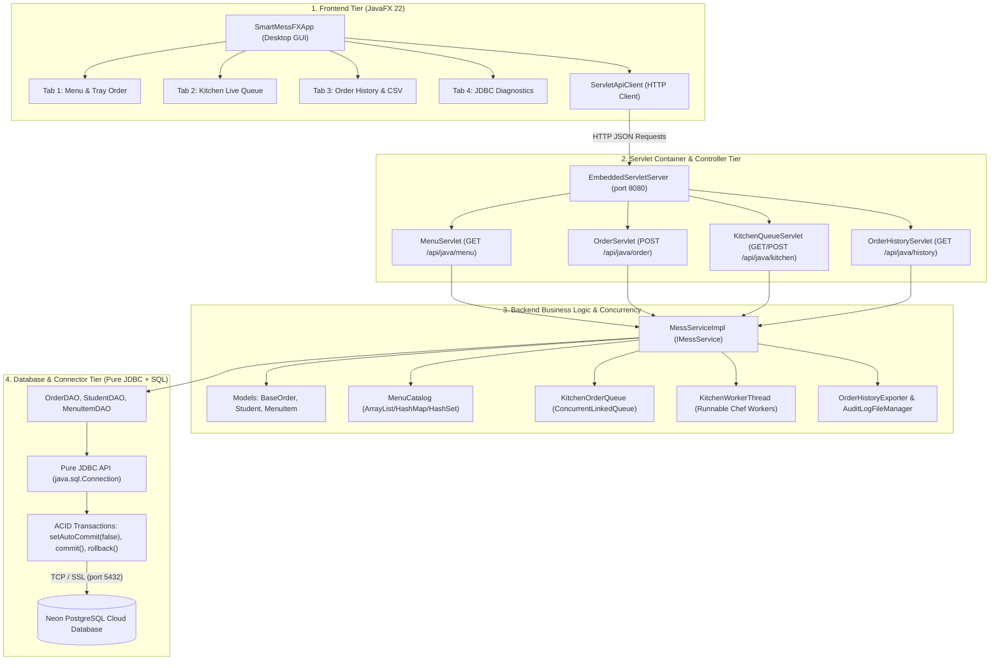

# SmartMess: Complete Java Full-Stack Architecture

> [!IMPORTANT]
> **Complete Architecture Delivered as Requested**:
> 1. **Frontend**: JavaFX Desktop Application ([`SmartMessFXApp.java`](file:///Users/rohit/.gemini/antigravity/scratch/smart-campus-mess/smartmess-java/src/main/java/com/smartmess/gui/SmartMessFXApp.java))
> 2. **Backend**: Java Core 22 ([`com.smartmess.*`](file:///Users/rohit/.gemini/antigravity/scratch/smart-campus-mess/smartmess-java/src/main/java/com/smartmess/))
> 3. **Database**: PostgreSQL SQL Database (Neon Cloud SQL + local fallback)
> 4. **Database API Connector**: Pure JDBC API (`java.sql.Connection`, `PreparedStatement`, `ResultSet`, ACID transactions with `commit()` and `rollback()`)
> 5. **Web API Runtime**: Standard Java Servlets (`javax.servlet.http.HttpServlet`, [`MenuServlet`](file:///Users/rohit/.gemini/antigravity/scratch/smart-campus-mess/smartmess-java/src/main/java/com/smartmess/servlet/MenuServlet.java), [`OrderServlet`](file:///Users/rohit/.gemini/antigravity/scratch/smart-campus-mess/smartmess-java/src/main/java/com/smartmess/servlet/OrderServlet.java), [`OrderHistoryServlet`](file:///Users/rohit/.gemini/antigravity/scratch/smart-campus-mess/smartmess-java/src/main/java/com/smartmess/servlet/OrderHistoryServlet.java), [`KitchenQueueServlet`](file:///Users/rohit/.gemini/antigravity/scratch/smart-campus-mess/smartmess-java/src/main/java/com/smartmess/servlet/KitchenQueueServlet.java))

---

## 1. Quick Start Commands

All commands are executed from the `smartmess-java` directory:

```bash
cd smartmess-java
```

### A. Launch the JavaFX Desktop GUI Application
```bash
bash run.sh gui
```
*Launches the interactive JavaFX desktop application. If the servlet container is not yet running, the desktop app automatically starts an embedded servlet server in the background so everything works immediately out of the box!*

### B. Launch Standalone Java Servlet Container
```bash
bash run.sh server 8080
```
*Starts the embedded Java servlet engine hosting all 4 servlets on port `8080`:*
- `GET  http://localhost:8080/api/java/menu?healthy=true` → Handled by `MenuServlet`
- `POST http://localhost:8080/api/java/order` → Handled by `OrderServlet`
- `GET  http://localhost:8080/api/java/kitchen` → Handled by `KitchenQueueServlet`
- `GET  http://localhost:8080/api/java/history?studentId=22` → Handled by `OrderHistoryServlet`
- `GET  http://localhost:8080/api/java/history?studentId=22&format=csv` → Handled by `OrderHistoryServlet` (CSV download)

### C. Run the Comprehensive Verification Test Suite
```bash
bash run.sh
```
*Executes all 7 core Java topics (OOP, Custom Exceptions, Collections, Multithreading, File I/O, JDBC Transactions, Servlets) sequentially with 100% automated test verification.*

---

## 2. Full-Stack System Architecture



---

## 3. Technology Stack Breakdown

| Layer | Technology | Key Implementation Files | Description |
| :--- | :--- | :--- | :--- |
| **Frontend** | **JavaFX 22** | [`SmartMessFXApp.java`](file:///Users/rohit/.gemini/antigravity/scratch/smart-campus-mess/smartmess-java/src/main/java/com/smartmess/gui/SmartMessFXApp.java)<br>[`SmartMessFXLauncher.java`](file:///Users/rohit/.gemini/antigravity/scratch/smart-campus-mess/smartmess-java/src/main/java/com/smartmess/gui/SmartMessFXLauncher.java) | Modern desktop client with dynamic category filtering, interactive meal tray, chef kitchen queue manager, order history table, and real-time execution log. |
| **HTTP Client** | **Java 11+ HttpClient** | [`ServletApiClient.java`](file:///Users/rohit/.gemini/antigravity/scratch/smart-campus-mess/smartmess-java/src/main/java/com/smartmess/client/ServletApiClient.java) | Asynchronously dispatches HTTP GET and POST requests from JavaFX to the servlet endpoints. |
| **Servlet Runtime** | **Java Servlet API** | [`EmbeddedServletServer.java`](file:///Users/rohit/.gemini/antigravity/scratch/smart-campus-mess/smartmess-java/src/main/java/com/smartmess/server/EmbeddedServletServer.java)<br>[`MenuServlet.java`](file:///Users/rohit/.gemini/antigravity/scratch/smart-campus-mess/smartmess-java/src/main/java/com/smartmess/servlet/MenuServlet.java)<br>[`OrderServlet.java`](file:///Users/rohit/.gemini/antigravity/scratch/smart-campus-mess/smartmess-java/src/main/java/com/smartmess/servlet/OrderServlet.java)<br>[`KitchenQueueServlet.java`](file:///Users/rohit/.gemini/antigravity/scratch/smart-campus-mess/smartmess-java/src/main/java/com/smartmess/servlet/KitchenQueueServlet.java)<br>[`OrderHistoryServlet.java`](file:///Users/rohit/.gemini/antigravity/scratch/smart-campus-mess/smartmess-java/src/main/java/com/smartmess/servlet/OrderHistoryServlet.java) | Handles RESTful HTTP requests, validates payloads, enforces HTTP status codes (`200 OK`, `201 Created`, `400 Bad Request`, `404 Not Found`), and serves JSON / CSV payloads. |
| **Backend Core** | **Java 22 (OOP & Threads)** | [`com.smartmess.model.*`](file:///Users/rohit/.gemini/antigravity/scratch/smart-campus-mess/smartmess-java/src/main/java/com/smartmess/model/)<br>[`com.smartmess.concurrency.*`](file:///Users/rohit/.gemini/antigravity/scratch/smart-campus-mess/smartmess-java/src/main/java/com/smartmess/concurrency/)<br>[`com.smartmess.exception.*`](file:///Users/rohit/.gemini/antigravity/scratch/smart-campus-mess/smartmess-java/src/main/java/com/smartmess/exception/) | Abstract classes, inheritance (`Student` extends `AbstractUser`, `RoomDeliveryOrder` extends `BaseOrder`), custom checked exceptions, concurrent chef threads, CSV file exporters. |
| **DB Connector** | **Pure JDBC API** | [`DatabaseConnection.java`](file:///Users/rohit/.gemini/antigravity/scratch/smart-campus-mess/smartmess-java/src/main/java/com/smartmess/db/DatabaseConnection.java)<br>[`OrderDAO.java`](file:///Users/rohit/.gemini/antigravity/scratch/smart-campus-mess/smartmess-java/src/main/java/com/smartmess/db/OrderDAO.java)<br>[`StudentDAO.java`](file:///Users/rohit/.gemini/antigravity/scratch/smart-campus-mess/smartmess-java/src/main/java/com/smartmess/db/StudentDAO.java)<br>[`MenuItemDAO.java`](file:///Users/rohit/.gemini/antigravity/scratch/smart-campus-mess/smartmess-java/src/main/java/com/smartmess/db/MenuItemDAO.java) | Uses standard `java.sql.Connection`, `PreparedStatement`, `ResultSet`. Enforces multi-table ACID transactions with `setAutoCommit(false)`, `commit()`, and `rollback()`. |
| **SQL Database** | **PostgreSQL (Neon Cloud)** | Tables: `students`, `menu_items`, `orders`, `order_items` | Relational SQL schema with foreign key constraints, numeric stock counters, credit ledgers, and token indexes. |

---

## 4. Evaluation Guide for Review 2

When your evaluators ask to see specific architectural tiers in VS Code:

| Requirement | Code File to Open in VS Code | What to Explain to Evaluators |
| :--- | :--- | :--- |
| **Frontend: JavaFX** | [`SmartMessFXApp.java`](file:///Users/rohit/.gemini/antigravity/scratch/smart-campus-mess/smartmess-java/src/main/java/com/smartmess/gui/SmartMessFXApp.java) | Explain the 4 tabs, `TableView` bindings, `ObservableList`, responsive button actions, and asynchronous thread dispatching. |
| **Backend: Java** | [`MessServiceImpl.java`](file:///Users/rohit/.gemini/antigravity/scratch/smart-campus-mess/smartmess-java/src/main/java/com/smartmess/service/MessServiceImpl.java) & [`BaseOrder.java`](file:///Users/rohit/.gemini/antigravity/scratch/smart-campus-mess/smartmess-java/src/main/java/com/smartmess/model/BaseOrder.java) | Explain OOP abstraction, polymorphism (`getPickupTokenPrefix()`), custom exceptions, and concurrent collections. |
| **Database: SQL Database** | [`DatabaseConnection.java`](file:///Users/rohit/.gemini/antigravity/scratch/smart-campus-mess/smartmess-java/src/main/java/com/smartmess/db/DatabaseConnection.java) | Show the PostgreSQL Neon connection URL and driver registration (`org.postgresql.Driver`). |
| **DB API Connector: JDBC** | [`OrderDAO.java`](file:///Users/rohit/.gemini/antigravity/scratch/smart-campus-mess/smartmess-java/src/main/java/com/smartmess/db/OrderDAO.java) | Highlight lines 29–135 showing `conn.setAutoCommit(false)`, `PreparedStatement`, row locking with `FOR UPDATE`, `conn.commit()`, and `conn.rollback()` in the `catch` block. |
| **Must Run on Java Servlet** | [`OrderServlet.java`](file:///Users/rohit/.gemini/antigravity/scratch/smart-campus-mess/smartmess-java/src/main/java/com/smartmess/servlet/OrderServlet.java) & [`EmbeddedServletServer.java`](file:///Users/rohit/.gemini/antigravity/scratch/smart-campus-mess/smartmess-java/src/main/java/com/smartmess/server/EmbeddedServletServer.java) | Show how the class extends `HttpServlet`, overrides `doPost()`, sets HTTP response headers, parses JSON with `BufferedReader`, and returns HTTP status `201 Created`. |
